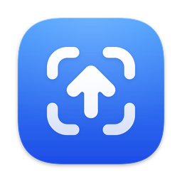
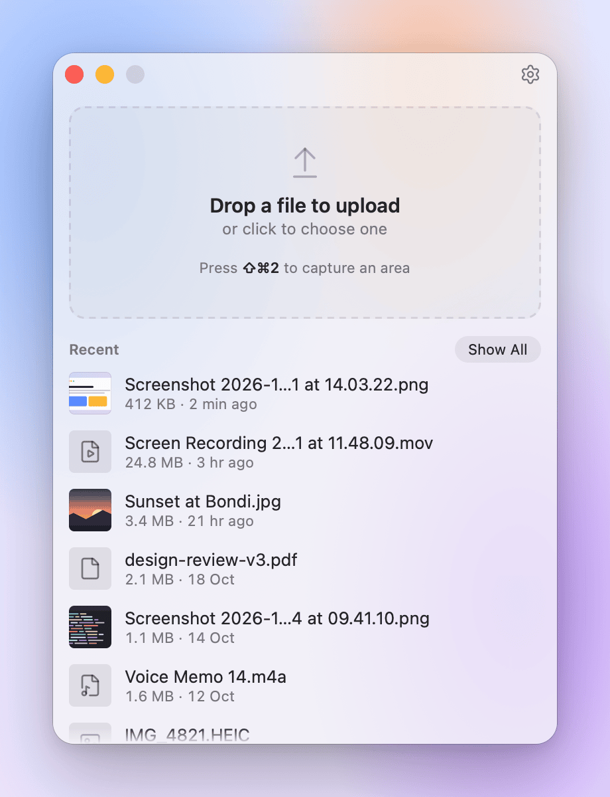
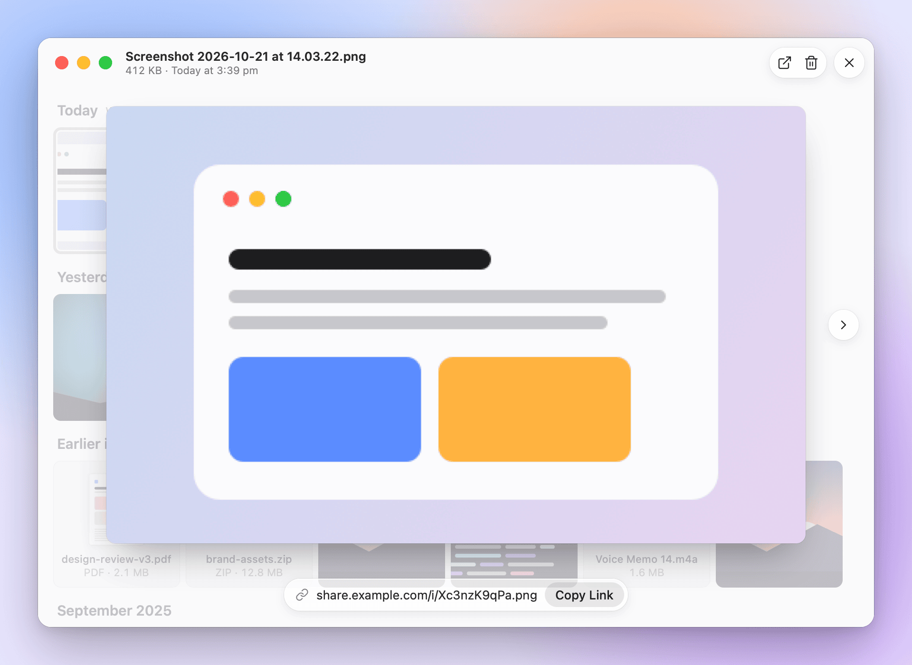
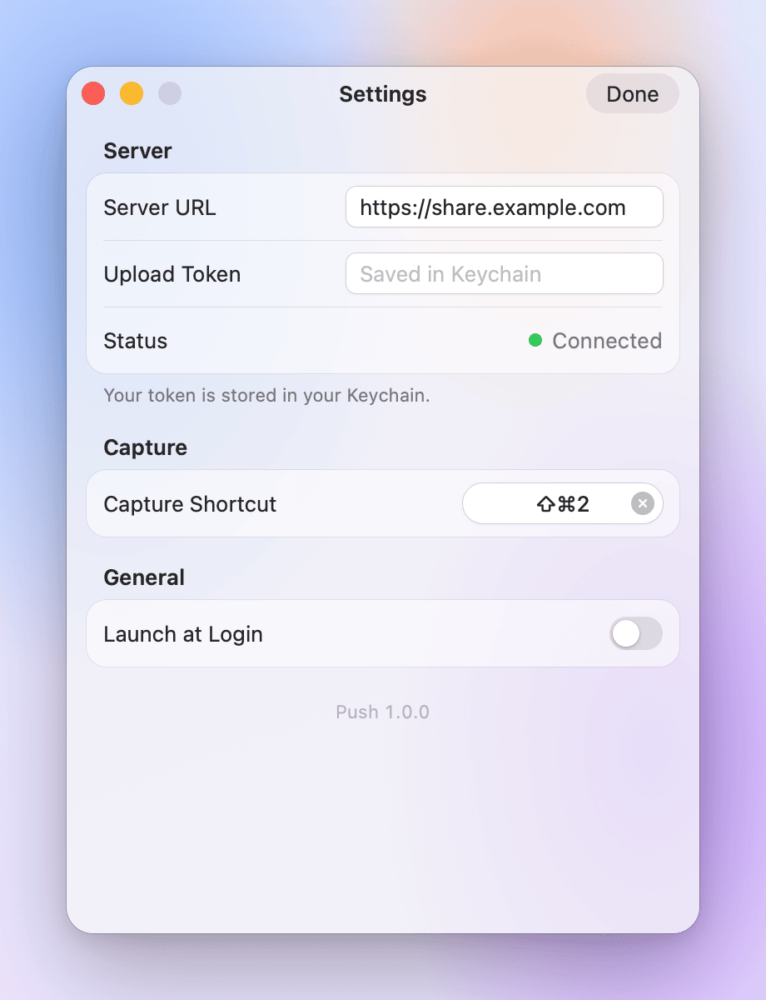
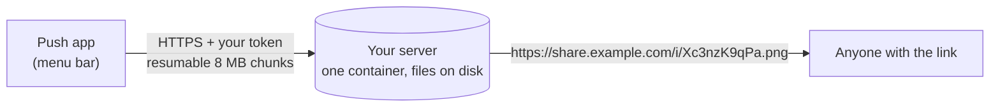

<div align="center">



# Push

**Screenshot. Upload. Link. On your own server.**

Press <kbd>⇧</kbd><kbd>⌘</kbd><kbd>2</kbd> (<kbd>Ctrl</kbd><kbd>Shift</kbd><kbd>2</kbd> on Windows and Linux), drag over anything on screen,<br>
and a private link is on your clipboard a second later.<br>
The file lives on a server you own. No accounts, no subscriptions, no one else's cloud.

[](LICENSE)


[](https://buymeacoffee.com/futsy)

[Get started](#get-started) · [Features](#why-push) · [Self-hosting guide](docs/DEPLOY.md) · [FAQ](#faq) · [Support Push](#support-push)

<br>

https://github.com/user-attachments/assets/718c1741-426a-442c-8ed5-d7b37846b530

</div>

## Why Push

Screenshot sharing apps are great until you remember where your screenshots go: someone else's servers, behind an
account, a subscription and a privacy policy. Push gives you the same one-second flow, pointed at a tiny server you run.

- **One shortcut, one link.** Capture an area or a window, or drop any file. The link is copied before you've switched
  apps, with a small native notification to confirm it.
- **Private by default.** Links are long random IDs that can't be guessed. Nothing is listed, indexed or archived,
  and only your devices (holding your token) can upload or delete.
- **Your server, your files.** One small Docker container, no database, files on plain disk. Back it up with `tar`.
  Move hosts whenever you like.
- **Any size.** Big screen recordings upload in resumable 8 MB chunks, so a dropped connection picks up where it left
  off, and it works happily behind Cloudflare.
- **Feels native.** Lives in the menu bar or system tray on macOS, Windows and Linux. Finder's Share menu, Send to on
  Windows, drag and drop, a Library with Quick Look style previews, light and dark mode, and keyboard shortcuts everywhere.
- **Links that unfurl.** Images and videos preview inline in Slack, Discord, X, Telegram and WhatsApp, and play right in
  the browser.

<table>
  <tr>
    <td width="33%" align="center">
      <picture>
        <source media="(prefers-color-scheme: dark)" srcset="docs/images/list-dark.png">
        
      </picture>
      <br><sub><b>Drop anything.</b> Recent uploads, one click to copy again.</sub>
    </td>
    <td width="33%" align="center">
      <picture>
        <source media="(prefers-color-scheme: dark)" srcset="docs/images/library-preview-dark.png">
        
      </picture>
      <br><sub><b>The Library.</b> Everything you've shared, searchable, with previews.</sub>
    </td>
    <td width="33%" align="center">
      <picture>
        <source media="(prefers-color-scheme: dark)" srcset="docs/images/settings-dark.png">
        
      </picture>
      <br><sub><b>Two settings.</b> Your server's address and your token.</sub>
    </td>
  </tr>
</table>

## Get started

You need a server you can run Docker on (any small VPS works) and a domain or subdomain for your links, like
`share.example.com`. Setup takes about ten minutes.

### 1. Run the server

Point your domain's DNS at the server, then on the server:

```sh
git clone https://github.com/itsfutsy/push.git && cd push
cp .env.example .env
openssl rand -hex 32     # this is your upload token
nano .env                # set PUSH_DOMAIN and PUSH_TOKEN
docker compose up -d
```

That's it: the server plus [Caddy](https://caddyserver.com) for automatic HTTPS. Already run Coolify, Dokploy, Traefik
or nginx? The [self-hosting guide](docs/DEPLOY.md) covers those, plus Cloudflare, backups and troubleshooting.

### 2. Install the app

**macOS 14 or later.** Build it with one script (it needs Xcode's command line tools and Rust):

```sh
xcode-select --install                               # once, if you don't have it
curl https://sh.rustup.rs -sSf | sh                  # once, if you don't have Rust
cargo install tauri-cli --version "^2.12" --locked   # once
git clone https://github.com/itsfutsy/push.git && cd push
scripts/build-macos.sh --install
```

This builds `Push.app`, installs it in `/Applications`, and turns on its Share extension.

**Windows 10 or 11.** Download the `x64-setup.exe` installer from
[Releases](https://github.com/itsfutsy/push/releases) and run it. It isn't code signed yet, so if SmartScreen warns,
choose **More info > Run anyway**. See [Windows notes](#windows-notes).

**Linux.** Grab the `.deb` or `.AppImage` from [Releases](https://github.com/itsfutsy/push/releases), or build it
yourself (see [Linux notes](#linux-notes)).

### 3. Connect

Open **Push > Settings**, enter `https://share.example.com`, and paste your token. When the status says
**Connected**, press <kbd>⇧</kbd><kbd>⌘</kbd><kbd>2</kbd> (<kbd>Ctrl</kbd><kbd>Shift</kbd><kbd>2</kbd> on Windows and
Linux). The first time, macOS asks for Screen Recording permission: allow Push in System Settings > Privacy & Security >
Screen & System Audio Recording.

## Using Push

| To | Do this |
|---|---|
| Capture part of the screen | <kbd>⇧</kbd><kbd>⌘</kbd><kbd>2</kbd> and drag. Press <kbd>Space</kbd> to capture a window instead, <kbd>Esc</kbd> to cancel. On Windows, <kbd>Ctrl</kbd><kbd>Shift</kbd><kbd>2</kbd> opens the snipping bar, with window and full screen modes. |
| Upload a file | Drop it on the Push window, click the drop area, use **Share > Push** in Finder, or drop it on Push.app. On Windows, right-click it and choose **Send to > Push**. |
| Upload several files | Drop them together. All their links go on the clipboard, one per line. |
| Copy a link again | Click a row in Recent, or preview a file in the Library and choose **Copy Link**. |
| Browse everything | **Show All** in the Push window, or **Library** in the menu bar or tray. Filter by type, search by name, press <kbd>Space</kbd> to preview and the arrow keys to step through. |
| Delete | Hover a row and choose Delete, or select tiles in the Library (<kbd>⌘</kbd>-click, <kbd>⇧</kbd>-click, <kbd>⌘</kbd><kbd>A</kbd>) and choose Delete. The link stops working right away. |
| Change the shortcut | Settings > Capture Shortcut. Holding both <kbd>⌘</kbd> keys works too (it needs Input Monitoring permission). |

## How it works



The app captures or picks a file, uploads it to your server, and copies the link. The server stores the file under a
random name and serves it to whoever has the link. That's the whole system.

<details>
<summary><b>Privacy and security details</b></summary>

<br>

- **Only you can upload.** Every write needs your token, checked before the server reads any data. Wrong and missing
  tokens get identical responses, compared in constant time.
- **The token stays put.** It's stored in your Keychain (Credential Manager on Windows, Secret Service on Linux) and
  never reaches the app's web view.
  The app never follows redirects, so the token can't be forwarded anywhere else.
- **Links can't be guessed.** File names are 10 random characters (about 60 bits) from the operating system's secure
  random generator. There are no listings, sitemaps or index pages.
- **Nothing gets indexed.** Every response tells search engines and archives to stay away, and `robots.txt` only lets
  link-preview bots fetch files.
- **Uploads can't attack viewers.** HTML, SVG, scripts and PDFs are always served as downloads, inside a locked-down
  content security policy sandbox, so a shared file can never run code on your domain.
- **The Share extension is sandboxed.** It has no network or keychain access; it only hands files to the app.

</details>

## FAQ

<details>
<summary><b>Do I need a domain?</b></summary>
<br>
Yes, links need an HTTPS address. A subdomain of a domain you already own is perfect. For local testing, the app also
accepts <code>http://localhost</code>.
</details>

<details>
<summary><b>Can I use it on more than one computer?</b></summary>
<br>
Yes. Install the app on each one and give them the same server address and token. Each keeps its own upload history.
</details>

<details>
<summary><b>How much does it cost to run?</b></summary>
<br>
Whatever your server costs. The server is one small Rust program, so the smallest VPS on any provider is plenty.
Storage is just your files.
</details>

<details>
<summary><b>macOS keeps asking for Screen Recording permission after I rebuild.</b></summary>
<br>
Builds without a Developer ID certificate are signed ad-hoc, and macOS treats each new build as a new app. Allow it
again, or set <code>PUSH_SIGN_IDENTITY</code> to your own signing identity before building.
</details>

## Windows notes

- Capturing uses Windows' own snipping bar (the one behind <kbd>Win</kbd><kbd>Shift</kbd><kbd>S</kbd>), so it needs
  Snipping Tool, which Windows includes. Depending on Snipping Tool's settings, Windows may also keep a copy in
  Pictures > Screenshots.
- Upload from File Explorer with **Send to > Push**, or from a terminal with `push FILE`.
- To build it yourself, install [Rust](https://rustup.rs) and run `cargo tauri build --bundles nsis` in `src-tauri`.

## Linux notes

- Global shortcuts work on X11. On Wayland, bind a system shortcut to `push --capture`
  (GNOME: Settings > Keyboard > Custom Shortcuts).
- Upload from a terminal with `push FILE`. For an "Upload with Push" item in Nautilus, save
  `#!/bin/sh` + `exec push "$@"` as `~/.local/share/nautilus/scripts/Upload with Push` and make it executable.
- The tray icon needs a StatusNotifier host (on GNOME, the AppIndicator extension).
- To build it yourself, install the packages listed in [`.github/workflows/linux.yml`](.github/workflows/linux.yml),
  then run `cargo tauri build --bundles deb,appimage`.

## Development

| Part | What it is |
|---|---|
| [`src-tauri/`](src-tauri), [`ui/`](ui) | The desktop app: Tauri 2 and Rust, with a plain HTML, CSS and JS interface. |
| [`macos/share/`](macos/share) | The macOS Share extension (Swift). |
| [`server/`](server) | The server: Rust (axum), one binary, no database. |
| [`dev/`](dev) | A browser preview of the interface with mock data, for working on the UI without the app. |

```sh
cd server && cargo run                               # server (needs PUSH_TOKEN, PUSH_PUBLIC_URL and PUSH_DATA_DIR)
cd src-tauri && cargo tauri dev                      # desktop app (PUSH_TOKEN=... skips the Keychain in debug builds)
python3 dev/serve.py                                 # UI preview: http://127.0.0.1:5174/dev/?s=list
scripts/check-linux.sh                               # compile the desktop app for Linux in Docker
```

## Support Push

Push is free for everyone, businesses included. If it saves you time, please consider
[buying us a coffee](https://buymeacoffee.com/futsy). And if your company uses Push for its team, a sponsorship
is hugely appreciated and keeps the project going.

<a href="https://buymeacoffee.com/futsy"></a>

## License

Copyright (C) 2026 Abram Industries Pty Ltd

Push is open source under the [MIT License](LICENSE).
